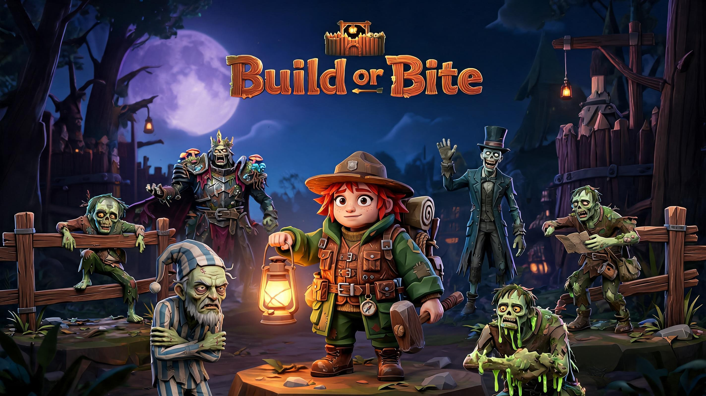
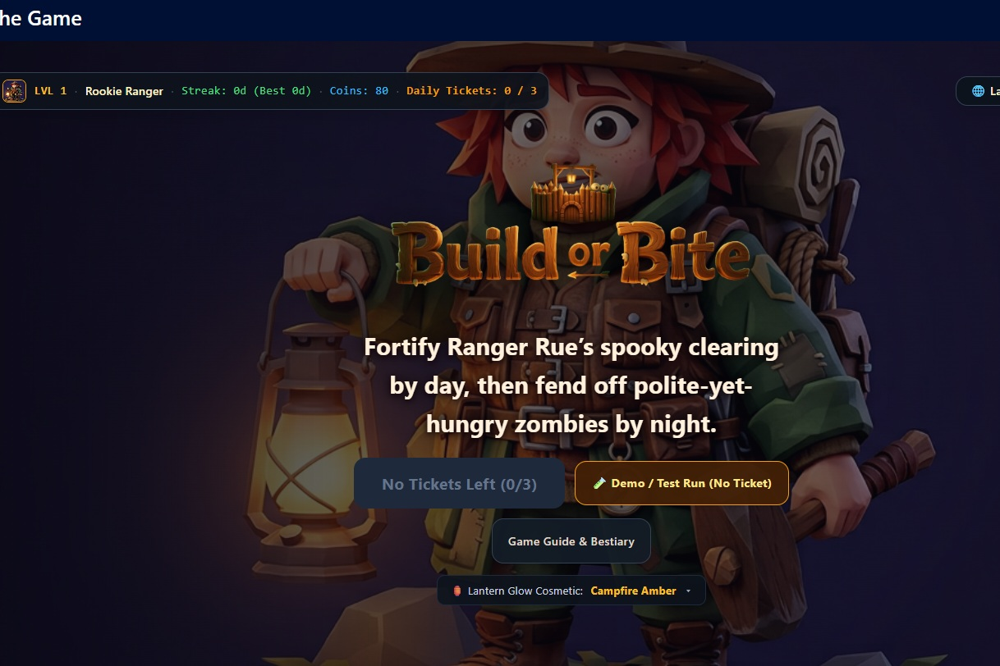

<p align="center">
  
</p>

<p align="center"><strong>Build by day. Bite back at night.</strong><br />
A spooky-funny 3D fort-defense game built for Reddit.</p>

<p align="center">
  
</p>

---

## Play and watch

- [Play on Reddit](https://www.reddit.com/r/playthisgames/comments/1xysvdh/build_or_bite_play_the_game/)
- [Reddit app listing](https://developers.reddit.com/apps/build-or-bite)
- [Watch the demo video](https://youtu.be/Y2rQ1czlRPs)
- [Devpost project](https://devpost.com/software/build-or-bite)

## The game

Help Ranger Rue gather supplies and turn a forest clearing into a fort. When night falls, fend off waves of cartoonish zombies and survive the final encounter with Baron Blight.

- **Gather & build:** collect wood, stone, and food; choose from six defensive structures.
- **Choose your upgrades:** pick one of two paths for each structure, then strengthen it to level 3. Fences can also reach level 3.
- **Survive three nights:** deploy your defenses, use the Lantern Flare, and protect the fort.
- **Return each day:** rebuild your daily fort while keeping XP, cosmetics, titles, and streaks.
- **Play on desktop or mobile:** keyboard and mouse controls are complemented by touch controls.

## Screenshots



Images in `docs/images/` are not included in the MIT source-code license; see the credits and license information below.

## How to play

**Day:** move to resource nodes, gather supplies, and use the build pads or fence button to construct, upgrade, and repair defenses. Each day lasts 65 seconds of active simulation; you can start night early. Upgrades to level 2 and 3 unlock on run Day 2 and Day 3 respectively.

**Night:** Rue and the defenses attack automatically. Use Lantern Flare strategically. Night ends once all zombies in the wave, including those still waiting to spawn, are defeated. Clear the third night to win; a destroyed fort or ending the run early is a defeat.

| Action | Desktop | Touch |
| --- | --- | --- |
| Move | WASD / arrow keys, or click | Tap or drag |
| Build or upgrade | Select a pad or fence | Tap a pad or fence |
| Lantern Flare | Space | Flare button |
| Start night early | Enter / N | — |
| Pause | P / Esc | Pause button |

## Reddit identity, tickets & saves

The Reddit version uses the Reddit user ID supplied to the Devvit server. A player who is signed in to Reddit does **not** need to create a separate game account or password. A valid Reddit session is required to load a profile and start a standard run; if the identity or save is unavailable, the game cannot load the profile.

Each player starts with **up to 3 tickets per UTC day**. A standard run costs one ticket, and tickets reset at **00:00 UTC**; unused tickets do not carry over. The first successfully started standard run each UTC day advances the daily streak, even if the run is not finished or tasks are incomplete. Further starts on the same day do not add streak days; missing a full UTC day breaks the streak. Demo runs never spend tickets or advance the normal streak. The server tracks starts and associates the profile with the Reddit user ID. The client submits fort and resource snapshots; these and gameplay events are not fully server-simulated or tamper-proof.

Daily tasks and their rewards are for standard play and can be earned once per UTC day. Farming and construction remain available after completing them. The fort, fences and resource wallet persist between runs within the same UTC day, then reset at 00:00 UTC. A run in progress is not interrupted; its old fort does not carry into the next UTC day.

### Demo mode

The Reddit app offers an isolated **Demo / Test Run** alongside standard play. It does not consume tickets or change normal progression. Tasks do not progress or pay rewards in Demo. Demo fort data is stored separately on the device; **Reset Demo Data** clears that sandbox and starts it with the initial fort and resources, without changing normal saves.

## Build and test

Requirements: Node.js 20.19+ or 22.12+ (use a Vite-supported Node.js release), npm, and a Devvit developer account for Reddit playtesting. No Gemini API key is required.

```bash
npm ci --legacy-peer-deps
npm run lint
npm test
npm run build
npm run build:devvit
```

For local standalone development, run `npm run dev`. The standalone browser version uses local storage rather than Reddit identity and server-enforced tickets.

To update a Devvit playtest:

```bash
npm run playtest:devvit -- <subreddit>
```

## Technology

React, TypeScript, Three.js, Vite, Tailwind CSS, and Reddit Devvit Web with a Hono server and Redis persistence.

```text
src/client/       Reddit splash and webview entrypoints
src/components/   Game screens, HUD, and menus
src/game/         Rules, simulation, audio, persistence, translations, tests
src/server/       Reddit identity, ticket, profile, and progression endpoints
public/assets/    Artwork, fonts, music, and sound effects
```

## Credits

- **Day music:** “Spooky Dungeon” by Memoraphile / You're Perfect Studio — [OpenGameArt](https://opengameart.org/content/spooky-dungeon), CC0.
- **Night music:** “Spooky Tune” by tamesu — [OpenGameArt](https://opengameart.org/content/spooky-tune), CC0.
- **Creepster font:** distributed under the SIL Open Font License; see `public/assets/fonts/Creepster-OFL.txt`.

Music licensing details and source links are in [music credits](public/assets/music/CREDITS.md); sound-effect sources and usage are in [sound-effect credits](public/assets/sfx/CREDITS.md).

## License

The project source code and documentation are licensed under the [MIT License](LICENSE). This license does not cover artwork or other media in `public/assets/` or `docs/images/`; those assets are subject to their own rights and licenses. See the credits above for music and font licenses. Third-party dependencies and Reddit's developer platform are subject to their respective licenses and terms.

## Submission status and limitations

A Reddit playtest has been confirmed playable by the developer. App Directory publication, production behavior, and the specific event's eligibility and submission requirements have not yet been verified. Automated tests and builds do not substitute for those checks.

The Reddit server enforces a daily ticket counter and bounds reported progression, but the game simulation, fort/resource snapshots, and victory events are client-reported. They are not authoritative against a determined attacker. Dependency security warnings should also be reviewed before release.
